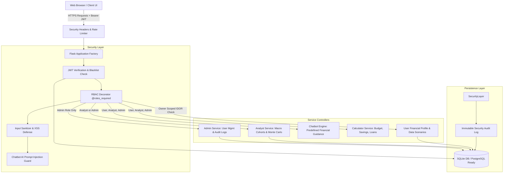

# FinSec AI: Secure Financial Analysis Chatbot with Role-Based Access Control (RBAC)

A production-grade, secure Financial Analysis Chatbot and Simulation Platform built with Python (Flask), SQLAlchemy, JWT session authentication, and Role-Based Access Control (RBAC).

---

## 1. System Architecture & Workflow Diagram



### Authentication & Authorization Flow
1. **Client Authentication**: Client submits credentials to `/api/v1/auth/login`.
2. **Password Verification**: Passwords are verified against scrypt/pbkdf2 cryptographic hashes with constant-time comparison.
3. **Cryptographic Token Issuance**: A signed JSON Web Token (JWT) is returned containing claims (`sub`, `username`, `role`, `jti`, `iat`, `exp`).
4. **Backend RBAC Enforcement**: Protected routes enforce `@jwt_required()` and `@roles_required(*roles)`. Tokens are checked against the `RevokedToken` table for instantaneous logout invalidation.
5. **IDOR & Data Scoping**: All user resources verify `resource.user_id == current_user.id` or require Admin override.
6. **Audit Logging**: All security-critical events (logins, role modifications, access control rejections, prompt injection attempts, IDOR attempts) are stored in `AuditLog` without exposing passwords or tokens.

---

## 2. RBAC Permission Matrix

| Capability / Endpoint | Admin | Financial Analyst | Standard User | Anonymous / Unauthenticated |
| :--- | :---: | :---: | :---: | :---: |
| **User Registration & Login** | ✅ | ✅ | ✅ | ✅ |
| **Financial AI Chatbot** (`/api/v1/chatbot/message`) | ✅ | ✅ | ✅ | ❌ (401) |
| **Financial Calculators** (`/api/v1/calculators/*`) | ✅ | ✅ | ✅ | ❌ (401) |
| **Manage Own Budgets/Goals** (`/api/v1/user/*`) | ✅ | ✅ | ✅ (Own Only) | ❌ (401) |
| **Access Other Users' Data (IDOR)** | ✅ (Audit Logged) | ❌ (403 Forbidden) | ❌ (403 Forbidden) | ❌ (401) |
| **Authorized Macro Datasets** (`/api/v1/analyst/datasets`) | ✅ | ✅ | ❌ (403 Forbidden) | ❌ (401) |
| **Macro Stress Testing** (`/api/v1/analyst/stress-test`) | ✅ | ✅ | ❌ (403 Forbidden) | ❌ (401) |
| **Monte Carlo Risk Projections** (`/api/v1/analyst/monte-carlo`) | ✅ | ✅ | ❌ (403 Forbidden) | ❌ (401) |
| **User Directory & Status** (`/api/v1/admin/users`) | ✅ | ❌ (403 Forbidden) | ❌ (403 Forbidden) | ❌ (401) |
| **Assign / Change Roles** (`/api/v1/admin/users/<id>/role`) | ✅ | ❌ (403 Forbidden) | ❌ (403 Forbidden) | ❌ (401) |
| **Admin Self-Demotion Defense** | ❌ (400 Prohibited) | N/A | N/A | N/A |
| **Review Security Audit Logs** (`/api/v1/admin/audit-logs`) | ✅ | ❌ (403 Forbidden) | ❌ (403 Forbidden) | ❌ (401) |
| **Application Security Config** (`/api/v1/admin/config`) | ✅ | ❌ (403 Forbidden) | ❌ (403 Forbidden) | ❌ (401) |

---

## 3. Project Directory Structure

```text
bcg/
├── .env                              # Active environment configuration
├── .env.example                      # Environment template without secrets
├── requirements.txt                  # Python dependencies
├── run.py                            # Application entrypoint & DB seeder
├── app/
│   ├── __init__.py                   # App factory, security headers, centralized error handlers
│   ├── config.py                     # Development, Testing, Production configurations
│   ├── extensions.py                 # SQLAlchemy, Flask-Limiter instances
│   ├── models/
│   │   ├── __init__.py               # Model exports
│   │   ├── user.py                   # User account & UserRole constants
│   │   ├── finance.py                # UserBudget, UserSavingsGoal, UserLoanScenario, AnalystDataset
│   │   ├── audit.py                  # Immutable AuditLog model & action constants
│   │   └── token_blocklist.py        # RevokedToken blocklist for instant logout invalidation
│   ├── security/
│   │   ├── __init__.py               # Security exports
│   │   ├── decorators.py             # @jwt_required, @roles_required, verify_ownership
│   │   ├── input_validator.py        # Input bounds checking, XSS sanitization, NIST password policy
│   │   └── guardrails.py             # Prompt injection detector & educational disclaimer
│   ├── services/
│   │   ├── __init__.py               # Service exports
│   │   ├── auth_service.py           # Registration, authentication, token issuance, revocation
│   │   ├── audit_service.py          # Centralized sanitized audit logging
│   │   ├── calculator_service.py     # 50/30/20 budget, compound savings, loan amortization
│   │   ├── chatbot_service.py        # Predefined financial domain knowledge base & fallback
│   │   └── analyst_service.py        # Macro datasets, stress test, Monte Carlo simulation
│   ├── routes/
│   │   ├── __init__.py               # Blueprint exports
│   │   ├── auth_routes.py            # /api/v1/auth (login, register, logout, me)
│   │   ├── chatbot_routes.py         # /api/v1/chatbot (message, suggested prompts)
│   │   ├── calculator_routes.py      # /api/v1/calculators (budget, savings, loan)
│   │   ├── user_routes.py            # /api/v1/user (summary, budgets, savings goals, loans)
│   │   ├── analyst_routes.py         # /api/v1/analyst (datasets, stress-test, monte-carlo)
│   │   └── admin_routes.py           # /api/v1/admin (users, roles, audit-logs, system-stats)
│   ├── static/
│   │   ├── css/
│   │   │   └── styles.css            # Dark/light theme, glassmorphism, responsive styles
│   │   └── js/
│   │       ├── api.js                # Authenticated HTTP client wrapper
│   │       ├── chatbot.js            # Chatbot interaction & message stream
│   │       ├── calculators.js        # Dynamic calculators with Chart.js
│   │       ├── analyst.js            # Analyst macro & Monte Carlo charts
│   │       ├── admin.js              # Admin user table & audit log viewer
│   │       └── app.js                # App lifecycle, RBAC tabs, demo switcher, toasts
│   └── templates/
│       └── index.html                # Semantic HTML5 single-page application
└── tests/
    ├── conftest.py                   # Pytest fixtures and seeded test database
    ├── test_auth.py                  # Auth, NIST password validation, token revocation
    ├── test_rbac.py                  # RBAC permission tests (Admin, Analyst, User)
    ├── test_security.py              # IDOR, SQLi, XSS, Prompt Injection, Token Tampering
    ├── test_calculators.py           # Mathematical accuracy of financial calculations
    ├── test_chatbot.py               # Chatbot intent matching and fallback tests
    └── verify_live_server.py         # Live HTTP server integration verification script
```

---

## 4. Database Schema

The database uses SQLAlchemy ORM with a migration-ready schema supporting both SQLite and PostgreSQL.

### `users` Table
| Column | Type | Constraints | Description |
| :--- | :--- | :--- | :--- |
| `id` | Integer | Primary Key, Auto-increment | Unique user identifier |
| `username` | String(50) | Unique, Not Null, Indexed | Alphanumeric handle |
| `email` | String(120) | Unique, Not Null, Indexed | Normalized email |
| `password_hash`| String(255) | Not Null | Cryptographic password hash |
| `role` | String(30) | Not Null, Default 'User' | `Admin`, `Financial Analyst`, or `User` |
| `is_active` | Boolean | Not Null, Default True | Account activation state |
| `created_at` | DateTime | Not Null | Account creation timestamp (UTC) |
| `last_login_at`| DateTime | Nullable | Last successful login timestamp (UTC) |

### `user_budgets` Table
| Column | Type | Description |
| :--- | :--- | :--- |
| `id` | Integer (PK) | Unique budget scenario ID |
| `user_id` | Integer (FK -> users.id) | Tenant owner ID (Cascades on delete) |
| `monthly_income` | Float | Net take-home income |
| `needs_amount` | Float | 50% / custom allocation for non-negotiable living expenses |
| `wants_amount` | Float | 30% / custom allocation for discretionary lifestyle |
| `savings_amount`| Float | 20% / custom allocation for emergency and retirement |
| `notes` | String(255) | User custom notes / plan title |
| `created_at` | DateTime | Timestamp of creation (UTC) |

### `user_savings_goals` Table
| Column | Type | Description |
| :--- | :--- | :--- |
| `id` | Integer (PK) | Unique savings goal ID |
| `user_id` | Integer (FK -> users.id) | Tenant owner ID |
| `title` | String(100) | Goal title (sanitized against XSS) |
| `target_amount` | Float | Financial target sum |
| `initial_deposit`| Float | Starting balance |
| `monthly_contribution` | Float | Monthly automated deposit |
| `annual_interest_rate` | Float | Compounding annual rate (%) |
| `time_horizon_years` | Integer | Projection duration in years |
| `projected_total` | Float | Calculated future value |
| `total_interest_earned` | Float | Gross interest component |

### `user_loan_scenarios` Table
| Column | Type | Description |
| :--- | :--- | :--- |
| `id` | Integer (PK) | Unique loan scenario ID |
| `user_id` | Integer (FK -> users.id) | Tenant owner ID |
| `loan_name` | String(100) | Description of obligation |
| `principal` | Float | Principal balance borrowed |
| `annual_rate` | Float | Annual percentage rate (APR %) |
| `term_months` | Integer | Loan duration in months |
| `monthly_payment` | Float | Fixed monthly payment |
| `total_interest` | Float | Total interest cost over term |
| `total_cost` | Float | Principal + total interest |

### `analyst_datasets` Table
| Column | Type | Description |
| :--- | :--- | :--- |
| `id` | Integer (PK) | Unique dataset record ID |
| `dataset_code` | String(50) | Unique identifier (e.g. `MACRO_INFLATION_BENCHMARK_2015_2024`) |
| `title` | String(120) | Dataset display title |
| `category` | String(50) | Category (`macro`, `benchmarks`, `credit`) |
| `description` | Text | Methodology description |
| `payload_json` | Text | JSON payload with data series |

### `audit_logs` Table
| Column | Type | Description |
| :--- | :--- | :--- |
| `id` | Integer (PK) | Unique audit sequence ID |
| `timestamp` | DateTime | Precise event timestamp (UTC) |
| `user_id` | Integer | Nullable user ID |
| `username` | String(50) | User handle or 'Anonymous' |
| `ip_address` | String(45) | Request IP address |
| `action` | String(50) | Event action constant |
| `resource` | String(150) | Target URI or resource path |
| `status` | String(20) | `SUCCESS`, `DENIED`, `WARNING`, `FAILED` |
| `details` | Text | Sanitized event context (zero credentials/PII) |

### `revoked_tokens` Table
| Column | Type | Description |
| :--- | :--- | :--- |
| `id` | Integer (PK) | Record ID |
| `jti` | String(36) | Unique JWT token UUID |
| `user_id` | Integer | Identifier of token owner |
| `revoked_at` | DateTime | Timestamp of revocation |
| `expires_at` | DateTime | Natural token expiration timestamp |

---

## 5. Safe Development-Only Demo Accounts

The application automatically seeds three demo accounts for testing all role capabilities:

| Role | Username | Email | Password | Allowed Capabilities |
| :--- | :--- | :--- | :--- | :--- |
| **Administrator** | `admin_sec` | `admin@finsec.local` | `AdminPassword!2026` | User directory, role assignment, audit logs, system stats, all tools |
| **Financial Analyst** | `analyst_jane` | `analyst@finsec.local` | `AnalystSecure!2026` | Macro datasets, stress testing, Monte Carlo risk models, chatbot, calculators |
| **Standard User** | `user_john` | `john@finsec.local` | `UserPassword!2026` | Chatbot, calculators, private budget/savings/loan management |

> **Security Note**: These credentials are strictly intended for local development and sandbox evaluation. In production environments, credentials must be generated dynamically with unique secrets.

---

## 6. Installation & Execution Guide

### Prerequisites
- Python 3.10+ (tested on Python 3.13)
- Modern web browser (Chrome, Edge, Firefox, Safari)

### Step 1: Clone / Navigate to Project Directory
```powershell
cd c:\Users\user\Downloads\bcg
```

### Step 2: Create and Activate Virtual Environment
```powershell
# Windows
python -m venv venv
.\venv\Scripts\Activate.ps1
```

### Step 3: Install Dependencies
```powershell
pip install -r requirements.txt
```

### Step 4: Configure Environment Variables
Copy `.env.example` to `.env`:
```powershell
cp .env.example .env
```

### Step 5: Run Automated Test Suite
Run the 28 unit and cybersecurity security tests:
```powershell
python -m pytest -v
```
Expected output:
```text
============================= 28 passed in 13.65s =============================
```

### Step 6: Start Application Server
```powershell
python run.py
```
Open your browser to:
```
http://127.0.0.1:5000
```

---

## 7. Step-by-Step Instructions to Run in Visual Studio Code

1. Open VS Code:
   ```powershell
   code .
   ```
2. Select Python Interpreter:
   - Press `Ctrl + Shift + P`
   - Type `Python: Select Interpreter`
   - Choose `./venv/Scripts/python.exe`
3. Open Terminal (`Ctrl + ~`) and start the server:
   ```powershell
   python run.py
   ```
4. Access the application in your browser at `http://127.0.0.1:5000`.
5. Use the **One-Click Demo Switcher** bar at the top to seamlessly toggle between **Standard User**, **Financial Analyst**, and **Administrator** perspectives.

---

## 8. Testing & Security Verification

The test suite thoroughly validates every security requirement:

| Test File | Test Case | Security Property Verified |
| :--- | :--- | :--- |
| `test_auth.py` | `test_login_success` | Valid credentials return JWT with correct claims & omit password hash |
| `test_auth.py` | `test_login_failed_invalid_password` | Rejects wrong password with HTTP 401 & audit log |
| `test_auth.py` | `test_password_strength_validation` | Enforces NIST complexity (10+ chars, upper, lower, number, symbol) |
| `test_auth.py` | `test_registration_privilege_escalation_defense` | Prevents self-registration with 'Admin' or 'Analyst' roles |
| `test_auth.py` | `test_logout_and_token_revocation` | Validates token is blacklisted on logout and cannot be reused |
| `test_rbac.py` | `test_admin_can_access_admin_endpoints` | Admin role can access `/api/v1/admin/users`, audit logs, and metrics |
| `test_rbac.py` | `test_user_cannot_access_admin_endpoints` | Standard User receives HTTP 403 Forbidden on admin endpoints |
| `test_rbac.py` | `test_analyst_cannot_access_admin_endpoints` | Financial Analyst receives HTTP 403 Forbidden on user management |
| `test_rbac.py` | `test_analyst_can_access_analysis_features` | Financial Analyst can access `/api/v1/analyst/datasets` and stress tests |
| `test_rbac.py` | `test_user_cannot_access_analyst_datasets` | Standard User receives HTTP 403 Forbidden on analyst datasets |
| `test_rbac.py` | `test_admin_can_change_user_role` | Administrator can reassign roles across the user directory |
| `test_rbac.py` | `test_admin_cannot_self_demote` | Prevents administrator from revoking own admin rights |
| `test_security.py` | `test_idor_defense_on_user_financial_data` | User B receives HTTP 403 when attempting to delete User A's budget |
| `test_security.py` | `test_sql_injection_defense` | ORM parameterized queries eliminate SQL injection (`' OR '1'='1`) |
| `test_security.py` | `test_xss_sanitization` | Script tags in inputs are HTML-encoded to prevent stored/reflected XSS |
| `test_security.py` | `test_prompt_injection_defense` | Chatbot rejects jailbreaks, system prompt extractions, and DAN attempts |
| `test_security.py` | `test_tampered_jwt_signature` | Modified JWT payloads are rejected with HTTP 401 |
| `test_security.py` | `test_missing_auth_header` | Protected endpoints reject unauthenticated requests |
| `test_calculators.py` | `test_budget_calculation_50_30_20` | Verifies mathematical accuracy of 50/30/20 budget allocations |
| `test_calculators.py` | `test_savings_compound_calculation` | Verifies compound interest formulas and trajectories |
| `test_calculators.py` | `test_loan_amortization_calculation` | Verifies loan monthly payments and amortization schedules |
| `test_chatbot.py` | `test_chatbot_savings_intent` | Verifies domain response on emergency funds and liquid savings |
| `test_chatbot.py` | `test_chatbot_fallback_unsupported_query` | Gracefully falls back on out-of-domain queries |

---

## 9. Troubleshooting & FAQ

### 1. `UnauthorizedAccess` / Script Execution Policy in PowerShell
If activating the virtual environment produces an execution policy error:
```powershell
Set-ExecutionPolicy -Scope Process -ExecutionPolicy Bypass
.\venv\Scripts\Activate.ps1
```

### 2. Port 5000 Already in Use
Specify custom host and port in `.env` or run directly:
```powershell
python -c "from app import create_app; app = create_app(); app.run(port=5050)"
```

### 3. Reset Database to Clean State
Delete `financial_chatbot.db` and re-run `python run.py`:
```powershell
rm financial_chatbot.db
python run.py
```

---

## 10. Educational Disclaimer & Assumptions
All financial calculations (50/30/20 budgets, compound interest growth, loan amortization schedules, macroeconomic stress tests, and Monte Carlo stochastic projections) are provided exclusively as **educational estimates**. They assume constant rates, timely payments, and gross yields without deducting individual tax liabilities, transaction friction, or unforeseen market disruptions. **This software does not provide certified fiduciary or legal investment advice.**
